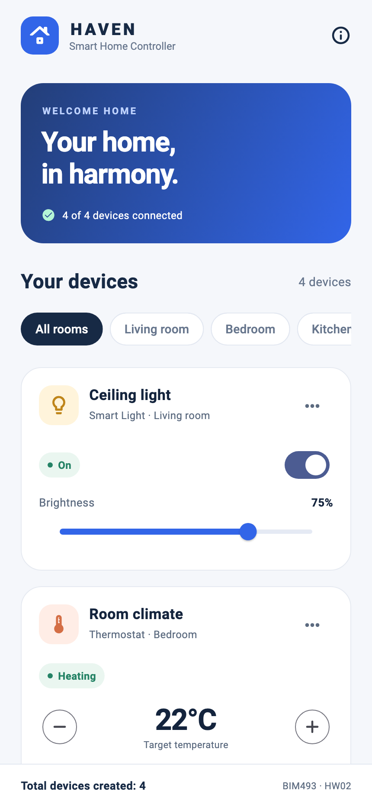
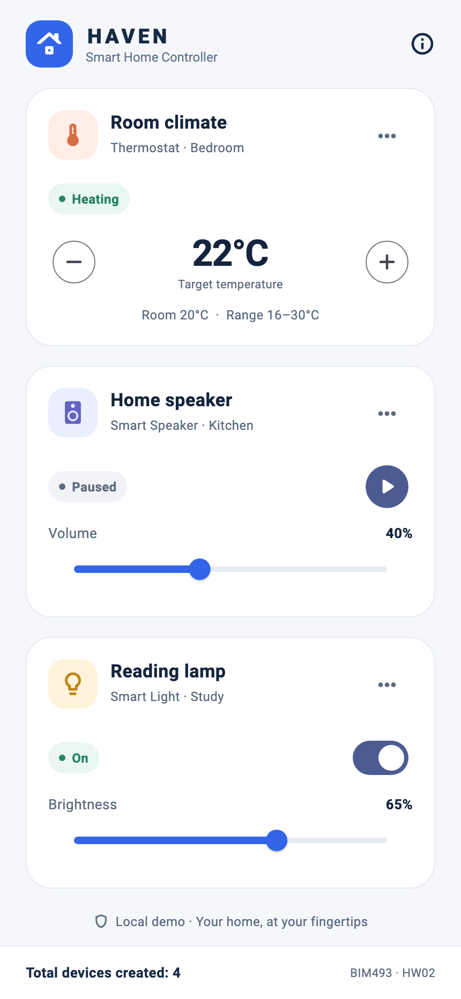
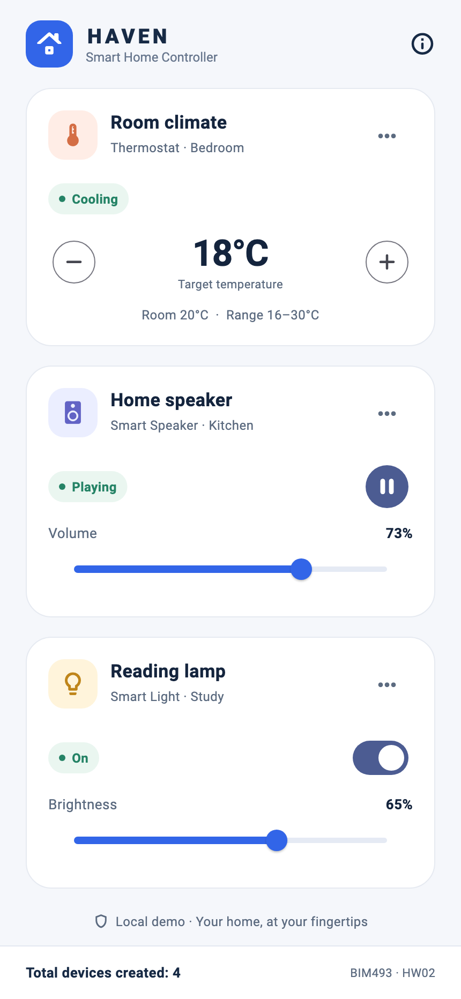
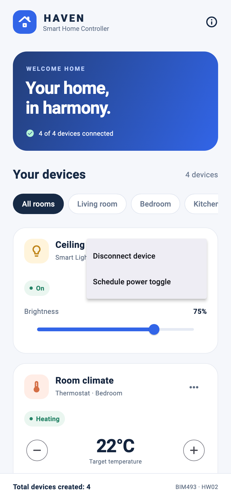
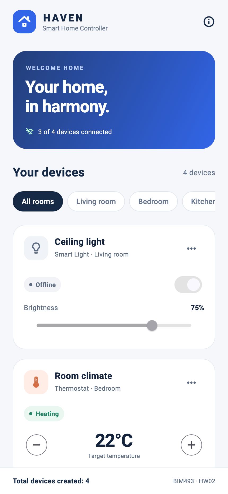
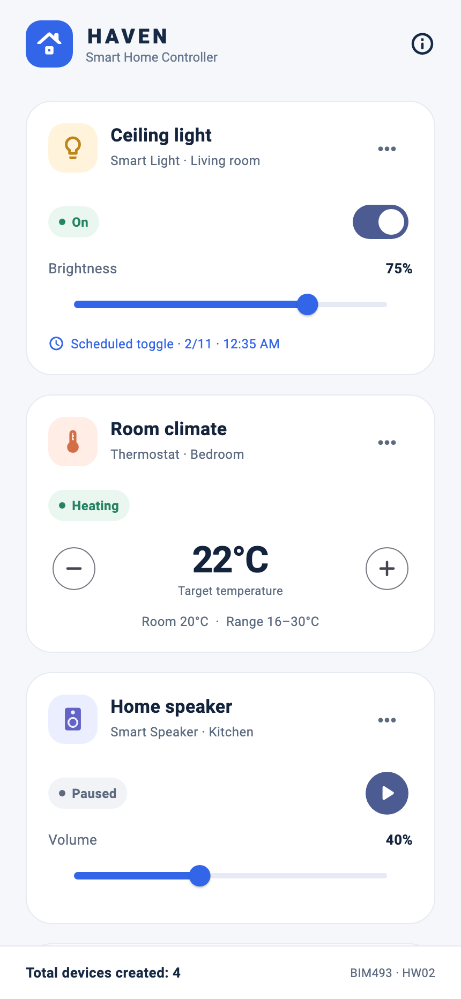
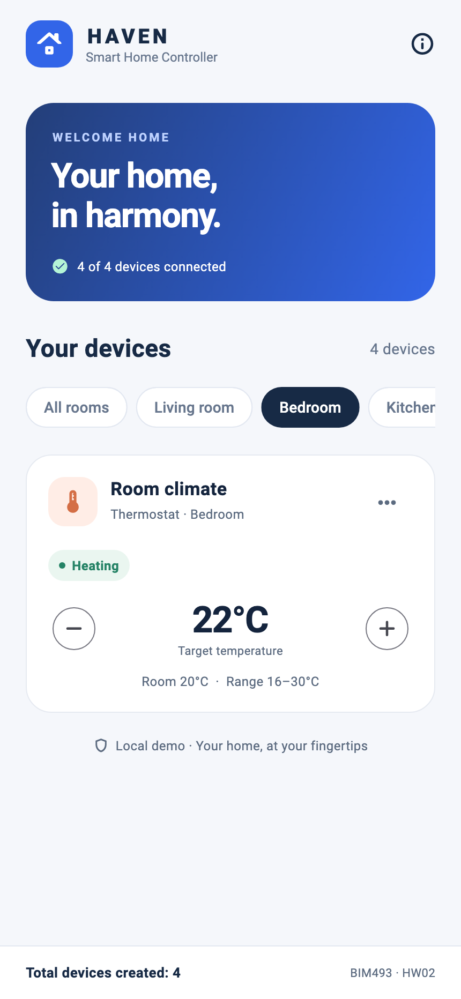
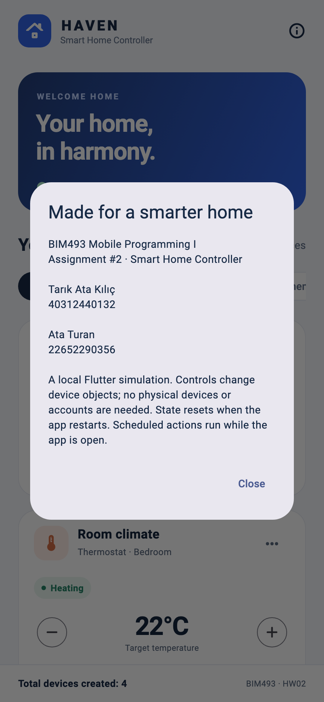
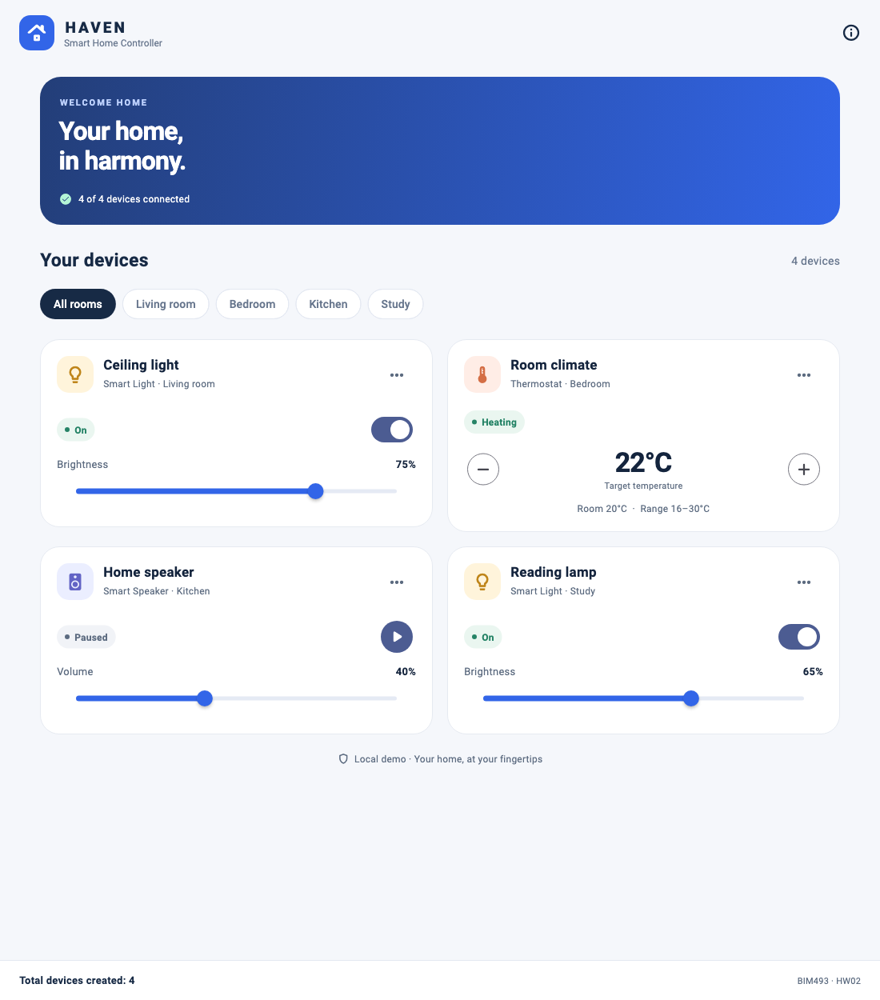

# Haven · Smart Home Controller

BIM493 - Mobile Programming I, Assignment 2, 2026-2027.

An English-language Flutter application that simulates a smart home controller. Four device objects (two smart lights, a thermostat and a smart speaker) are modeled with Dart object-oriented features and controlled from one dashboard. No account, network service or physical device is needed.

## Team

- **Tarık Ata Kılıç** - 40312440132
- **Ata Turan** - 22652290356

## Toolchain

Developed with **Flutter 3.47 on the Stable channel** (3.47.7 on Windows 11 and 3.47.9 on macOS). The minimum SDK in `pubspec.yaml` is Dart 3.9 (Flutter 3.35); `flutter analyze`, `flutter test` and the web build also pass with Flutter 3.35.7.

`flutter --version` output from the macOS test machine:

```text
Flutter 3.47.9 • channel stable • https://github.com/flutter/flutter.git
Framework • revision c197ca5199 (3 days ago) • 2026-10-29 10:10:20 -0400
Engine • hash 9e025265bef30b838c0c1b68cad19decf97048f2 (revision 89c39edfdf) (5 days ago) • 2026-10-27 19:51:20.000Z
Tools • Dart 3.13.7 • DevTools 2.60.0
```

The SDK itself is not included in the source archive.

## Setup and run

Install Flutter and add its `bin` directory to PATH. For Android, install Android Studio with its Android SDK and start an emulator or connect a device with USB debugging enabled. Then run these commands from the project root (the folder containing `pubspec.yaml`):

```sh
flutter --version
flutter doctor
flutter pub get
flutter devices
flutter run
```

To preview the same Flutter interface in Chrome:

```sh
flutter run -d chrome
```

On macOS with Xcode, `flutter run -d <ios-simulator-id>` runs the app on an iOS simulator.

### Validation and builds

```sh
flutter analyze
flutter test --reporter expanded
flutter build web --release
```

Serve the web build with an HTTP server, because `file://` is unsupported: `python3 -m http.server 8080 --directory build/web` (use `python` on Windows), then open `http://localhost:8080`.

Android SDK tools were not installed on the test machines, so no APK build or Android device test is claimed; the assignment asks for the Flutter project source code, not an APK. The iOS simulator build was checked on macOS. Android, iOS and web platform projects are included. Exact results are in `docs/VERIFICATION.md`.

## Features

- A dashboard with a welcome banner that shows how many devices are connected, a room filter (All rooms, Living room, Bedroom, Kitchen, Study) and one card per device.
- **Smart Light** (Ceiling light, Reading lamp): on/off switch and brightness slider (0–100%). Brightness is kept while the light is off; the slider is disabled until it is turned on again.
- **Thermostat** (Room climate): minus/plus buttons change the target between 16 and 30°C. The status compares the target with the simulated room temperature of 20°C: Heating, Cooling or At target.
- **Smart Speaker** (Home speaker): play/pause button and volume slider (0–100%). Playback is simulated; no audio is streamed.
- Each card's options menu disconnects or reconnects the device through the `Connectable` interface. An offline device shows **Offline**, its controls are disabled and the banner count updates. Disconnecting the speaker also pauses it.
- Lights can **schedule a power toggle** through the `Schedulable` mixin. The card shows the scheduled date and time; the toggle runs once while the app is open, and an offline light waits until it is reconnected. **Cancel schedule** removes it.
- The footer shows **Total devices created**, read from the static `SmartDevice.totalDevicesCreated` counter. Filtering and controls never create new devices, so it stays at 4.
- The info button shows the course, the assignment and the team members.

## Screenshots

Captured directly from the actual Flutter widget renderer at a 430 x 932 logical-pixel viewport, exported at 2x. `dashboard.png` shows the two-column layout at 1100 x 1250.

| Dashboard | Thermostat and speaker |
| --- | --- |
|  |  |

### Controls, connection, scheduling and filtering

| Light off | Changed controls | Options menu | Offline device |
| --- | --- | --- | --- |
|  |  |  |  |

| Scheduled toggle | Room filter | Team info |
| --- | --- | --- |
|  |  |  |

### Wide layout



## Assignment requirements

### Classes and Dart features

| Concept | Implementation |
| --- | --- |
| **Class** | Base class `SmartDevice` (`lib/models/smart_device.dart`) and the subclasses `SmartLight`, `Thermostat`, and `SmartSpeaker` (`lib/models/smart_light.dart`, `thermostat.dart`, `smart_speaker.dart`). |
| **Objects** | `lib/data/demo_devices.dart` creates four objects: two `SmartLight`, one `Thermostat`, and one `SmartSpeaker`. `HomeScreen.initState()` creates the list once, outside `build()`, and every object is displayed as a card. |
| **Constructor** | Default (unnamed) constructors: `SmartLight(...)` and `Thermostat(...)`. Named constructors: `SmartLight.reading(...)` and `SmartSpeaker.lounge(...)`. Both kinds are used to create the objects in `demo_devices.dart`. |
| **Inheritance** | `SmartLight`, `Thermostat`, and `SmartSpeaker` each `extends SmartDevice`. |
| **Abstraction** | `SmartDevice` is an `abstract class` with the abstract method `String getStatus()`; every subclass overrides it. |
| **Interface** | `Connectable` (`lib/models/connectable.dart`) declares `connect()` and `disconnect()`. All three device classes `implements Connectable`, and each card's options menu calls these methods. |
| **Mixin** | `mixin Schedulable` (`lib/models/schedulable.dart`) adds one-shot scheduling. `SmartLight` uses it with `with Schedulable` (options menu → **Schedule power toggle**). |
| **Keywords** | `static`: `SmartDevice.totalDevicesCreated` (also `Thermostat.minTemperature` and `maxTemperature`). `super`: each subclass constructor calls `super(id: id, name: name, room: room)`. `this`: the base constructor uses `this.id`, `this.name`, and `this.room`, and the named constructors redirect with `this(...)`. |

Polymorphism: a `List<SmartDevice>` stores the different device objects, and each card calls `device.getStatus()` through the base type.

### Expected output (UI screen)

- [x] **Device List:** one card per device: Smart Light (two cards), Thermostat and Smart Speaker ([screenshot](docs/screenshots/dashboard.png)).
- [x] **Device Information:** each card shows the device name, its type and room, the relevant property (brightness %, target temperature °C, volume %) and the current status returned by `getStatus()` ([screenshot](docs/screenshots/02-thermostat-speaker.png)).
- [x] **Interaction:** Smart Light has an on/off switch and a brightness slider, Thermostat has minus/plus temperature buttons, and Smart Speaker has a play/pause button and a volume slider ([screenshot](docs/screenshots/04-controls.png)).
- [x] **Bottom Text:** the footer shows **Total devices created: 4**, read directly from the static variable `SmartDevice.totalDevicesCreated`. The `SmartDevice` constructor increments it, so the value does not come from the list length, and it stays at 4 after filtering ([screenshot](docs/screenshots/08-room-filter.png)).

## Verification checklist

The 16 model tests and 7 widget tests cover:

- Default and named constructors each increment the static counter exactly once; reading state and using controls never change it.
- Every device class implements `Connectable`, and `getStatus()` returns the subclass-specific status (On/Off, Heating/Cooling/At target, Playing/Paused, Offline).
- Light power and brightness bounds, thermostat 16–30°C bounds and statuses, speaker play/pause and volume bounds.
- Offline devices reject changes, disconnecting pauses the speaker, and reconnecting restores control.
- `Schedulable`: the action runs once when due, waits while the device is offline, and can be cancelled or replaced.
- All four cards with their initial values, the switch, sliders and buttons, disconnect/reconnect and the banner count, room filtering with the same objects and footer count, scheduling through the real time picker, the team info dialog, and a 320 x 740 viewport at 150% text scale without overflow.

See `docs/VERIFICATION.md` for exact execution results.

## Source organization

- `lib/main.dart`: app entry point and theme.
- `lib/models/smart_device.dart`: abstract base class, static counter and abstract `getStatus()`.
- `lib/models/smart_light.dart`, `thermostat.dart`, `smart_speaker.dart`: device subclasses with default and named constructors.
- `lib/models/connectable.dart`: `Connectable` interface.
- `lib/models/schedulable.dart`: `Schedulable` mixin.
- `lib/models/devices.dart`: exports all model files.
- `lib/data/demo_devices.dart`: creates the four device objects.
- `lib/screens/home_screen.dart`: dashboard, room filter, schedule timer and static footer.
- `lib/widgets/device_card.dart`: device card with model-backed controls.
- `test/`: model and widget tests.
- `docs/`: verification notes and screenshots.
- `tools/package_submission.py`: creates the submission ZIP.

State updates use simple `setState`, with no state-management library. The home screen owns the device objects, and the cards change those same objects.

## References

- [Flutter documentation](https://docs.flutter.dev/)
- Dart [classes](https://dart.dev/language/classes), [constructors](https://dart.dev/language/constructors), [mixins](https://dart.dev/language/mixins) and [class modifiers](https://dart.dev/language/class-modifiers-for-apis)

## Scope and limitations

State is held in memory and resets when the app restarts. Scheduling runs only while the app is open; it is not an operating-system alarm. There are no real smart-home devices, accounts or network services. Android emulator/device behavior was not tested.

## License

MIT, see `LICENSE`. Material Icons come from the Flutter SDK; see the [Flutter license](https://github.com/flutter/flutter/blob/master/LICENSE) and the [Material Icons license](https://github.com/google/material-design-icons/blob/master/LICENSE).

## Submission

Public repository: https://github.com/krainox02/40312440132_22652290356_Smart_Home_Controller_HW2

The source ZIP, `HW2_Tarik_Ata_Kilic_40312440132_Ata_Turan_22652290356.zip`, carries both student IDs in its name and contains the same files as the repository: platform folders, source, `pubspec.yaml`, `pubspec.lock`, tests, screenshots and documentation. It excludes `build/`, `.dart_tool/`, IDE caches and local SDK paths. Recreate it in `output/` with `python3 tools/package_submission.py`.

Submit the repository and/or archive link through ESTUOYS by **November 10, 2026, 23:59 (UTC+3)**.
